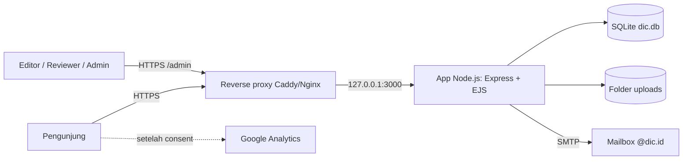
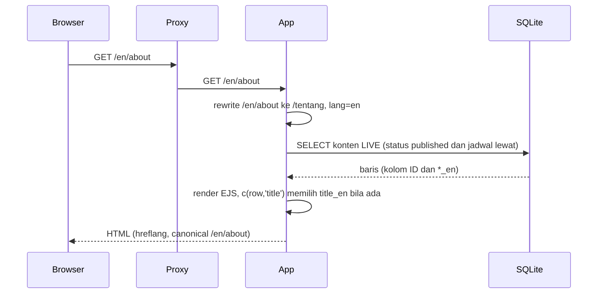
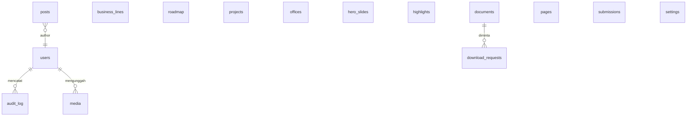
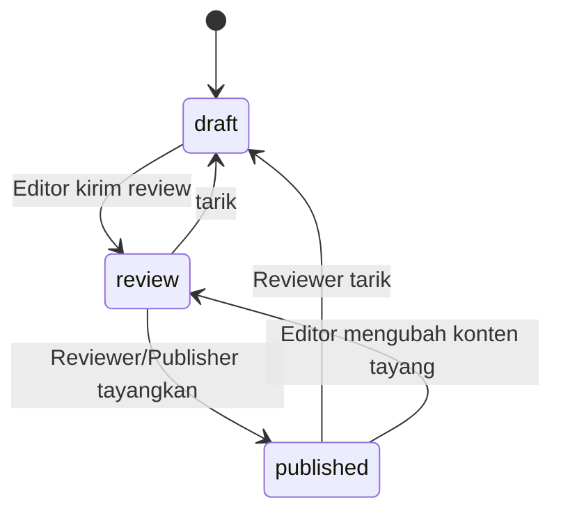

# Arsitektur dic.id (HLD dan LLD)

Klasifikasi: **RESTRICTED**. Dokumen ini menjelaskan desain aplikasi website dan CMS, bukan infrastruktur data center DIC.

## 1. Tujuan dan batasan desain

| Kebutuhan (Assessment) | Keputusan desain |
|---|---|
| 5 halaman + detail berita, pencarian, footer (A#5) | Server-side rendering (EJS), tanpa framework frontend |
| CMS dengan editor, reviewer, admin, draft, preview, jadwal tayang (A#24) | CMS buatan sendiri di aplikasi yang sama, workflow tiga status |
| Form kontak, simpan di CMS dan kirim email, retensi 12 bulan (A#9, A#10) | Tabel `submissions`, pengiriman SMTP di latar belakang, purge terjadwal |
| Bahasa Indonesia dan English (permintaan lanjutan) | Prefix `/en`, kolom `*_en`, kamus UI |
| Bedakan realisasi dan rencana, izin publikasi (A#18 sampai A#20) | Label per item, guard pada proyek, item belum disetujui tidak tayang |
| Performa dan SEO (sheet 03) | HTML ringan, gambar responsif WebP, metadata, sitemap, hreflang |
| Operasi sederhana oleh tim kecil | Satu proses Node.js, SQLite, satu volume data |

## 2. Konteks sistem

## 3. Komponen

| Komponen | Lokasi | Tanggung jawab |
|---|---|---|
| Server dan middleware | `src/server.js` | Helmet (CSP), sesi cookie, static assets, mount `/admin`, `/en`, `/`, error handler, purge retensi |
| Router publik | `src/routes/public.js` | Halaman, pencarian, form kontak, unduhan, sitemap, robots |
| Router admin | `src/routes/admin.js` | Login, CRUD generik berbasis resource, workflow, pengaturan, pengguna, pesan, media, audit |
| Definisi resource | `src/resources.js`, `src/settingsDef.js` | Satu definisi menghasilkan daftar, form, validasi, dan kolom English |
| Database | `src/db.js` | Skema, migrasi ringan, kondisi `LIVE`, cache pengaturan, audit |
| i18n | `src/i18n.js` | Kamus UI, pemetaan path `/en`, helper `__`, `u`, `c`, `dateL` |
| Email | `src/lib/mail.js` | Notifikasi PIC, autoresponse dua bahasa, outbox sandbox |
| Gambar | `src/lib/img.js` | Varian WebP responsif, atribut `srcset`, dimensi |
| Auth dan CSRF | `src/lib/auth.js` | Peran, sesi, token CSRF |
| Seed dan sandbox | `src/seed.js`, `src/seed-en.js`, `src/sandbox.js` | Konten awal, terjemahan English, instance demo |

## 4. Alur request

Form kontak: `POST /kontak` (atau `/en/contact`) melewati rate limit, parser, cek CSRF, honeypot, waktu minimum, validasi, `INSERT submissions`, lalu redirect (PRG). Email notifikasi dan autoresponse dikirim di latar belakang dan status ditulis ke `email_status` sehingga kegagalan terlihat di CMS.

## 5. Model data

Semua tabel konten memiliki kolom workflow: `status` (`draft`, `review`, `published`), `publish_at`, `updated_by`, `created_at`, `updated_at`. Field teks yang tampil publik memiliki kolom `<nama>_en` (dibuat oleh migrasi di `src/db.js`). Konten tayang bila `status='published'` dan (`publish_at` kosong atau sudah lewat).

## 6. Workflow dan peran

| Aksi | Editor | Reviewer/Publisher | Admin |
|---|---|---|---|
| Buat dan ubah konten, kirim review | ya | ya | ya |
| Tayangkan, tarik, jadwalkan | tidak | ya | ya |
| Hapus | hanya draft | ya | ya |
| Pustaka media (unggah) | ya | ya (hapus juga) | ya |
| Pesan masuk dan export | hanya bila ditandai | hanya bila ditandai | ya |
| Pengaturan, pengguna, audit | tidak | tidak | ya |

Proyek (rekam jejak) tidak dapat ditayangkan tanpa Sumber, Tanggal as-of, dan Pemberi izin (guard di `src/resources.js`).

## 7. Bahasa

- URL English memakai path English (`/en/about`, `/en/business-lines`). Middleware di `src/server.js` menulis ulang ke path internal Indonesia sehingga router hanya satu.
- Teks UI: kamus `EN` di `src/i18n.js` (kunci adalah teks Indonesia). Konten CMS: kolom `*_en`, fallback ke Indonesia bila kosong.
- Setiap halaman memuat `hreflang` (id, en, x-default) dan sitemap memuat kedua bahasa.
- Istilah English pada teks Indonesia tidak diterjemahkan.

## 8. Keamanan (ringkas)

Rincian ada di [SECURITY.md](../SECURITY.md). Zona dan kontrol:

| Zona | Kontrol |
|---|---|
| Internet ke proxy | TLS 1.2+, redirect HTTP ke HTTPS, batas ukuran body |
| Proxy ke app | Hanya `127.0.0.1:3000`, `TRUST_PROXY=1`, header `X-Forwarded-Proto` |
| App | CSP, CSRF, rate limit, sanitasi input, parameterized SQL, peran |
| Data | File DB dan uploads dimiliki user aplikasi, backup terenkripsi di luar server |
| Email | SMTP terautentikasi, pesan notifikasi memuat data minimum |

## 9. Performa

HTML dirender di server tanpa JavaScript framework, CSS tunggal, font Inter dilayani dari server sendiri, gambar disajikan dalam varian WebP 480/800/1280 piksel dengan atribut `width`/`height`. Hasil Lighthouse ada di [GO-LIVE-CHECKLIST.md](GO-LIVE-CHECKLIST.md).

## 10. Keputusan arsitektur

| Keputusan | Alasan | Konsekuensi |
|---|---|---|
| Node.js + SQLite, bukan WordPress | Permintaan eksplisit Node.js; WordPress di konsep hanya usulan (A#25). Satu proses, backup satu file | Satu instance saja; HA memerlukan pindah ke PostgreSQL |
| SSR EJS | Performa dan SEO tanpa build step | Interaktivitas ringan (carousel, menu) memakai JS kecil |
| CMS generik berbasis resource | Menambah modul cukup menambah definisi | UI admin sederhana, bukan page builder |
| Kolom `*_en` | Terjemahan berdampingan di form, mudah ditinjau | Bahasa ketiga memerlukan migrasi kolom |
| Email di latar belakang dengan status | Form tidak gagal karena SMTP; kegagalan terlihat dan dapat dikirim ulang | Pengiriman ulang manual oleh PIC |

## 11. Batasan dan pengembangan lanjutan

Tidak ada riwayat revisi per konten, tidak ada replikasi database, pencarian memakai `LIKE`. Fase berikut menurut assessment: karier, portal vendor, WBS, newsletter (A#30).
